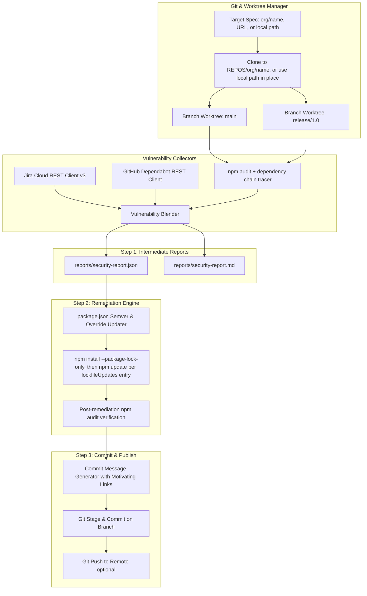

# Security Vulnerability Blender & Automated Remediation Engine (`security-report`)

## 1. Executive Summary & Design Rationale

Managing security vulnerabilities across large Node.js / npm codebases is typically fragmented:
- **npm audit** detects package-level vulnerabilities and identifies affected sub-graphs, but is branch-local and lacks business context.
- **Jira CVE tickets** track security compliance, CVE identifiers, SLAs, and security team workflows, but lack automated code-level remediation links.
- **GitHub Dependabot** flags alert numbers and repository security advisories, but automated PRs frequently create merge conflicts across multiple release branches.

This project unifies all three sources across multiple Git branches in a single repository and provides a 3-step automated workflow:
1. **Aggregate & Analyze (Step 1)**: Ingest `npm audit` across branches (isolated via Git worktrees), blend with Jira CVE tickets and GitHub Dependabot alerts, trace direct vs. indirect ancestor chains, and generate a normalized intermediate report (`JSON` and `Markdown`).
2. **Remediate (Step 2)**: Execute safe, deterministic dependency updates modeled after `npm-check-updates` (`package.json` updates first, followed by atomic lockfile synchronization and post-remediation audit verification).
3. **Commit & Trace (Step 3)**: Generate rich conventional Git commit messages linking CVEs, Jira tickets, Dependabot alerts, and exact ancestor chains, and commit directly to the target branches.

---

## 2. System Architecture & Data Flow



---

## 3. Directory & Component Structure

```
security-report/
├── package.json               # Node.js ESM configuration & dependencies (commander, semver)
├── README.md                  # User-facing usage, configuration, and CLI reference
├── AGENTS.md                  # System design rationale and architecture documentation
├── .gitignore                 # Excludes REPOS/, reports/, .worktrees/ and .security-report.json
├── bin/
│   └── sec-remediate.js       # CLI executable entrypoint (chmod +x)
├── src/
│   ├── index.js               # Core library orchestrator (scanRepository, remediateRepository)
│   ├── cli.js                 # Commander CLI definitions (scan/report, fix/remediate)
│   ├── config.js              # Configuration loader (env vars, config files, CLI options)
│   ├── core/
│   │   ├── git-manager.js     # Clone/fetch, credential-free auth, worktree lifecycle & branch commits
│   │   ├── dependency-graph.js# Ancestor chain resolution (direct vs. transitive hierarchy)
│   │   ├── blender.js         # Tri-source blending (npm audit + Jira CVEs + Dependabot alerts)
│   │   ├── remediator.js      # package.json and package-lock.json update & verification engine
│   │   └── commit-generator.js# Formats commit messages with CVE, Jira, Dependabot & chain metadata
│   ├── collectors/
│   │   ├── npm-audit.js       # npm audit --json, findings extraction & remediation strategy builder
│   │   ├── jira.js            # Pure JS deterministic Atlassian Jira Cloud REST client
│   │   ├── dependabot.js      # Pure JS GitHub Dependabot Alerts REST client
│   │   └── advisories.js      # GHSA/CVE resolution via GitHub Advisory API with OSV fallback
│   └── report/
│       ├── json-reporter.js   # Intermediate JSON report generator
│       └── markdown-reporter.js # Human-readable Markdown summary generator
└── test/
    ├── git-manager.test.js    # Repo spec parsing, credential redaction, worktree & branch-commit behaviour
    ├── audit-collector.test.js# Audit parsing, chain tracing, remediation strategies & reporting
    ├── remediator.test.js     # package.json modification, change de-duplication and overrides handling
    ├── external-collectors.test.js # Jira/Dependabot parsing, blending and configuration loading
    ├── integration.test.js    # End-to-end multi-branch scan, report, and commit creation
    └── arborist-resolution.test.js # Arborist virtual tree resolution, monorepo workspaces & multi-scenario remediation
```

---

## 4. Key Design Decisions

### A. Repository Isolation, Remote Synchronization & Multi-Branch Worktrees
- **Problem**: Switching branches in a single working copy invalidates `node_modules`, risks uncommitted changes, and prevents parallel branch analysis. Furthermore, stale local caches might not reflect new commits pushed to the remote repository.
- **Solution**:
  1. **Remote Fetch on Each Run**: `ensureRepo` executes `git fetch --all --prune --tags` to guarantee all remote branch pointers (`origin/*`) are up to date.
  2. **Remote HEAD Reset**: `createWorktree` creates worktrees with `git worktree add -B <branch> <worktreeDir> origin/<branch>`, automatically resetting and fast-forwarding the local branch to the latest remote HEAD on every report run.
  3. **Base Detachment & Branch Commits**: Base repositories — including repositories targeted by a local path — are detached (`git checkout --detach`, logged when it happens) so all branch names remain available for worktrees and no commit can land on a detached worktree HEAD. Worktree commits therefore advance `refs/heads/<branch>` directly; when they cannot (branch held by another worktree), `stageAndCommit` performs a compare-and-swap `git update-ref refs/heads/<branch> <new> <old>` or aborts with the holding worktree's path rather than stranding the commit.
  4. **Worktree Retention**: `withWorktree` removes the worktree only after the callback succeeds. `sec-remediate fix` without `--commit` keeps it and prints its path, because it is the only copy of the applied fix; a failed callback keeps it too.

### B. Direct vs. Indirect Ancestor Chain Resolution & 5-Tier Remediation Strategy
- **Problem**: `npm audit` reports hoisted paths (e.g. `node_modules/@xmldom/xmldom`), obscuring the logical parent (e.g. `msw -> @mswjs/interceptors -> @xmldom/xmldom`). Furthermore, `npm audit --json` returns every intermediate carrier package as a vulnerability record, inflating vulnerability counts.
- **Solution**: `src/collectors/npm-audit.js` ignores pure intermediate packages whose `via` contains only string references and no direct advisory objects. `src/core/dependency-graph.js` combines `npm ls --all --json` traversal and reverse graph backtracking over `package-lock.json` packages to reconstruct the complete logical ancestry tree down to root `package.json` dependencies. Strategy selection itself lives in `buildRemediationSuggestion` (`src/collectors/npm-audit.js`), with per-package consolidation in `src/core/blender.js`.
- **5-Tier Remediation Strategy** (first match wins):
  1. **`bump-direct`**: Directly updates `package.json` if the package is declared in `dependencies`/`devDependencies`.
  2. **`bump-direct-and-lockfile`**: Same as above when the package is *also* pulled in transitively (`Direct & Indirect`); the package.json bump is paired with a lockfile re-resolution for the remaining instances. See section H.
  3. **`bump-direct-parent`**: If a direct root parent (e.g. `msw`) has an updated version available that pulls in the safe dependency, updates the direct parent in `package.json`.
     Parent-update candidates must be strictly newer than installed parent versions across every affected declaration/origin. Do not trust npm audit's `fixAvailable` as proof of a forward upgrade; reject lower/equal candidates and preserve a safe fallback without partial workspace edits.
  4. **`lockfile-update`**: Requests re-resolution within the final manifest's parent ranges, without persistent overrides. The selected execution direction is transient, version/ancestor-scoped pins to realize approved targets, followed by removal of those generated pins and graph verification against the final manifest. This policy is not yet implemented by the current npm named-update path; see section D. `npm install <pkg>@<version>` is deliberately not used because it can add a transitive package to root `package.json`.
  5. **`package-override`**: A persistent pin must be explicitly justified and present in the reviewed plan. A no-op lockfile update is not permission to introduce an override silently; incompatible parent ranges may instead require a parent upgrade or manual review.

Every strategy carries `packageJsonChanges` (file-scoped semver edits) and `lockfileUpdates` (package names to re-resolve). `remediateBranch` de-duplicates both across findings — for a package targeted by several advisories, the highest requested version wins.

### C. Deterministic JS Clients & Automatic Configuration Validation
- **Decision**: Uses native Node.js `fetch` and ESM modules for Jira and Dependabot REST communication rather than external runtime dependencies or MCP bridges.
- **Jira Integration**: Targets Jira Cloud's `/rest/api/3` endpoints only (a `POST /search/jql` fallback covers the removal of the GET form); Jira Server / Data Center `/rest/api/2` is **not** supported. Authenticates with Basic Auth (`email` + `apiToken`) or a Personal Access Token (Bearer).
- **Graceful Degradation**: If the Jira collector is enabled but its configuration is incomplete (missing `baseUrl` or `apiToken`), the tool automatically disables the Jira collector, logs an informative notice, and continues scanning with remaining enabled collectors without crashing.
- **Dependabot Integration**: Uses GitHub REST API (`/repos/{owner}/{repo}/dependabot/alerts`) with bearer token authentication.
- **Credential Handling**: `GITHUB_TOKEN` is never embedded in a clone URL. `parseRepoSpec` always produces a credential-free remote; `gitAuthEnv` passes `Authorization: Basic <base64(x-access-token:TOKEN)>` per invocation through `GIT_CONFIG_COUNT`/`GIT_CONFIG_KEY_0`/`GIT_CONFIG_VALUE_0`, so the token reaches neither `argv` (visible via `ps`) nor `.git/config`. Every `execGit` failure message is passed through `redactCredentials` before it is thrown or logged.
- **Configuration Isolation**: `loadConfig({ noConfigFile: true })` skips `.security-report.json` / `security-report.config.json` discovery entirely. Tests MUST set it — otherwise `node --test` picks up the developer's real credentials and issues authenticated Jira/GitHub requests.

### D. 3-Step Remediation Pipeline
1. **Step 1 (Intermediate Report)**: Aggregates findings and generates a single structured JSON schema + Markdown file before touching any code.
2. **Step 2 (Remediation)**:
   - Modifies `package.json` while maintaining exact original file indentation.
   - Currently attempts `npm install --package-lock-only` followed by one `npm update <pkg> --package-lock-only` per requested package, with lifecycle scripts disabled. These operations are not proof that transitive copies changed.
   - Proves the resulting dependency graph against every approved resolution, then re-runs `npm audit`. A command exit code of zero or a changed lockfile alone is not success. If a vulnerable instance remains unchanged or an approved target is not realized, fail verification, retain the worktree, and prevent commit/push/PR.
3. **Step 3 (Commit Message Generation)**:
   - Formats a conventional commit message with CVE identifiers, Jira ticket URLs, Dependabot alert links, dependency chains, and verification status.


#### Transitive resolution: evidence and selected policy

- **Observed limitation:** `npm update joi --package-lock-only` left the user's lockfile unchanged. Do not recommend named updates as a reliable solution for this repository or rerun them to dispute that observation. Direct `reify({ update: { names: [...] } })` uses the same named-update mechanism, which excludes bundled/shrinkwrapped nodes.
- **Audit-fix API:** `arb.audit({ fix: true })` loads audit evidence, queues vulnerable nodes' parents, and gives the resolver vulnerable ranges to avoid. A scratch-registry experiment updated a purely transitive dependency with `packageLockOnly: true`, `ignoreScripts: true`, and `force: false`, without changing the manifest, adding overrides, or writing `node_modules`. This is not proof against the user's actual graph.
- **Audit selection experiment:** There is no public package whitelist for `audit({ fix: true })`. Auditing first, filtering the resulting report's package entries and `topVulns`, building the ideal tree, then calling `reify()` updated only the selected direct or transitive package in separate scratch experiments. This manipulates implementation-dependent state; it is not a supported hard scope boundary. Calling `audit({ fix: true })` afterward reloads the full report. Peer resolution, hoisting, and dependency changes still require a strict graph-diff guard. Jira-only findings absent from npm audit need another path.
- **Latest user decision:** Prefer transient pins for in-range updates rather than adopting audit-report mutation as the execution mechanism. This supersedes the earlier prohibition on temporary pins. It records the chosen direction, not a completed implementation.
- **Execution sequence:** Apply reviewed manifest edits; add only the generated version/ancestor-scoped temporary overrides needed for approved targets; resolve the lockfile with lifecycle scripts disabled; remove only those generated overrides, preserving pre-existing overrides and reviewed persistent edits; verify the resulting graph against the final manifest without temporary pins; then audit.
- **Scope and cleanup:** Keep installed major/minor target groups independently scoped; never impose one global version across incompatible groups. Track generated edits so cleanup on success or failure restores the intended final manifest without deleting unrelated overrides or user changes. Temporary pins must not be committed.
- **Final validity:** Every target must satisfy the final manifest's original or reviewed parent constraints after temporary pins are removed. Otherwise require a reviewed parent upgrade, persistent override, or manual review. A transient pin must not conceal an invalid final graph or add a root transitive declaration.
- **No second unconstrained install:** Do not run an unconstrained install after removing temporary pins; it can undo the selected lockfile resolutions. Verification must prove approved per-origin targets and reject changes outside the reviewed scope. A command exit code of zero is not success; failure retains the worktree and prevents publication.

---
### E. Upstream Branch to Downstream Version Translation Table
- **Problem**: Jira CVE tickets are filed against downstream product releases (e.g. `[mta-8.2]`, `[mta-8.1]`, `affectsVersions: ["MTA 8.2.0"]`), while the codebase uses upstream Git branch names (`main`, `release-0.12`, `release-0.11`, `release-0.10`).
- **Solution**: `src/config.js` and `src/core/blender.js` maintain a configurable translation table (`branchMap`) mapping upstream branches to target downstream versions.
- **Matching Rule**: When auditing `release-0.11`, the blender only correlates tickets affecting `8.2.x` / `mta-8.2` (e.g. `MTA-7680`). When auditing `release-0.10`, it correlates tickets affecting `8.1.x` / `mta-8.1` (e.g. `MTA-7679`).

### F. Unified Upstream Branch Grouping across Collectors
- **Problem**: `npm-audit` naturally evaluates branch worktrees individually, but external API collectors (`jira`, `dependabot`) return repository-wide or project-wide lists.
- **Solution**: All collection files record `repository` and `branches[].packages[].findings`, with source-specific issue/advisory/CVE records stored once:
  - `debug-collection-jira.json`: Groups tickets by mapped upstream branch and package. Tickets without branch/version evidence remain package-grouped in `unassigned`; no `allTickets` copy is emitted.
  - `debug-collection-dependabot.json`: Groups alerts by package only on GitHub's actual repository default branch. The first requested branch is never assumed to be the default; unselected default-branch findings remain in the collection without leaking into release reports.
  - `debug-collection-npm-audit.json`: Groups each branch's audit advisories by package, retaining physical instances and root/workspace origins rather than serializing worktree internals or repeating package-level CVEs.
- **Blender handoff**: The blender collates every collector's evidence per branch/package into canonical `findings` and deduplicated `affectedVersions` range/first-patched-version pairs. The registry safety assessment, report, and planner consume these fields directly rather than reconstructing evidence. With `--debug`, `debug-blended.json` projects only repository identity and branches with `branch`, optional `baseCommit`/`error`, and `packages: [{ packageName, findings, affectedVersions }]`; failed branches have empty packages. It excludes snapshots, Arborist trees, and legacy evidence copies.
- **Benefit**: Debug collections consistently represent repository → branch → package → issue/advisory/CVE, and the blender consumes the explicit branch groups without flat-list fallback. All four debug artifacts are written only when debug is enabled.

### G. Advisory Resolution (Jira & npm audit) & Optimal Safe Version Calculation
- **Problem**: Jira CVE tickets and npm audit findings point to GitHub Security Advisories or CVE identifiers, but do not natively provide all upstream npm package fix versions or direct links.
- **Solution**:
  1. `src/collectors/jira.js` queries `/rest/api/3/issue/{key}/remotelink` to extract attached GHSA and CVE URLs; `src/collectors/npm-audit.js` extracts GHSA/CVE identifiers from `via` advisory objects.
  2. `src/collectors/advisories.js` (`fetchAdvisoryDetails`) queries GitHub Advisory API (and OSV API fallback), resolving CVE IDs, `vulnerableVersionRange`, and `first_patched_version` across all affected releases.
  3. `src/core/blender.js` preserves all advisory intervals and their paired first-patched versions in canonical package evidence. The remediation planner selects safe per-installed-line patch targets from the branch's published release catalog, using that evidence.
  4. `src/report/markdown-reporter.js` links npm audit sources directly to the resolved GitHub Security Advisories.

### H. Upstream Lockfile Assessment for Jira Findings & Dual Direct/Indirect Resolution
- **Problem**: Jira tickets track downstream flaws, but the tool needs to know what is actually installed in the target branch's `package-lock.json`. Furthermore, packages like `js-yaml` may be both directly declared in `package.json` and pulled in transitively by tools like `eslint`.
- **Solution**:
  1. `src/core/dependency-graph.js` (`lookupPackageInstalledInfo`) scans the branch worktree's `package.json` and `package-lock.json` to extract all installed versions (e.g. `3.15.1, 4.3.1`) and ancestor paths.
  2. Detects dual dependency status: `dependencyType: "Direct & Indirect"`.
  3. Formulates a dual resolution plan (`bump-direct-and-lockfile`): updates the `package.json` semver constraint for the direct dependency AND lists the package in `remediation.lockfileUpdates`, so `npm update <pkg> --package-lock-only` synchronizes all transitive instances.


### I. npm Workspaces & Monorepo Direct Dependency Support
- **Problem**: In monorepos using npm workspaces (`workspaces: ["packages/*"]`), direct dependencies can be declared in nested `package.json` files (e.g. `packages/ui/package.json`) rather than only root `package.json`.
- **Solution**:
  1. `src/core/dependency-graph.js` (`findWorkspacePackageJsons`, `getDirectDependencies`) discovers all nested workspace packages.
  2. Dependency checks aggregate direct dependencies across root and all workspaces, tracking the exact declaring workspace and file path.
  3. Remediation (`updatePackageJsonFile`) updates the specific workspace `package.json` file where the dependency is declared.


### J. Multi-Line Patched Version Extraction & In-Major Remediation
- **Problem**: Flaws in popular packages (e.g. `fast-uri`, `semver`) are frequently patched across multiple active major version lines (e.g. `2.4.5`, `3.1.6`, `4.1.3`). Grabbing only the first or lowest patched version either leaves the package vulnerable on newer lines or forces an unnecessary breaking upgrade across major versions.
- **Solution**:
  1. `src/collectors/advisories.js` (`fetchAdvisoryDetails`) collects all `first_patched_version` entries from GitHub Advisories and `fixed` events from OSV across the npm ecosystem.
  2. `src/collectors/npm-audit.js` (`determinePatchedVersions`) parses multiple patch boundaries from compound semver ranges (e.g. `<2.4.5 || >=3.0.0 <3.1.6 || >=4.0.0 <4.1.3`).
  3. `src/core/blender.js` (`selectBestRemediationVersion`) prioritizes safe, non-breaking in-major patch updates when the current installed version is known (e.g. installed `2.4.2` selects `2.4.5`; installed `3.1.3` selects `3.1.6`), or selects the minimal breaking jump.
  4. `src/report/markdown-reporter.js` (`formatTargetFix`) uses blended `affectedVersions` and canonical findings to display the minimum stable version safe against every finding per installed major, not every advisory patch boundary. Omit unused majors; if an affected installed major has no safe candidate, display the minimum necessary higher-major fix. This report minimum does not change the planner's newest-published-safe-patch policy on each installed major/minor line; keep full advisory evidence in details.

### K. Upstream Resolution Tracking & Open vs. Resolved Status
- **Problem**: Downstream Jira compliance tickets or Dependabot alerts often remain open/active even after an upstream repository has already applied the fix in its lockfile. Continuing to flag them as active defects or attempting code modifications causes confusion and redundant diffs.
- **Solution**:
  1. `src/core/blender.js` (`isVulnerabilityResolved`) compares all installed versions against target fixes across major version lines and validates against `vulnerableVersionRange`.
  2. Packages satisfying target fixes are marked `pkg.status = 'resolved'`, clearing pending remediation edits/lockfile updates and recording an informational note.
  3. `src/report/markdown-reporter.js` displays a dedicated `Status` column with `✅ Resolved` vs `⚠️ Open` in the overview table, and adds status badges/notes in the detailed package findings.

### L. Partitioned Dependency Path Reporting in Markdown
- **Problem**: Conflating direct dependencies and transitive paths leads to duplicate output or confusing traces in the detailed findings section.
- **Solution**:
  1. `src/report/markdown-reporter.js` splits paths into `formatDirectDependencyPaths` and `formatTransitiveDependencyPaths`.
  2. Direct dependencies strictly pull from workspace/root declarations and are excluded from transitive output.
  3. Both sections render in compact code blocks (`<pkgFile>/<section>/...`) for consistency and readability.
  4. Installed/current-version lists are deduplicated and sorted by semver, not lexical order. Report ancestry uses exhaustive physical-instance origins with per-path cycle detection; a shared hoisted node must not suppress another root/workspace's path. Scoped names and manifest/location-specific ranges remain intact.


### M. Arborist-Powered Virtual Dependency Resolution & Multi-Scenario Remediation
- **Problem**: Custom regex parsing of `package-lock.json` and string-keyed maps (`dependentsMap`) lead to false cross-product ancestry when a package is installed at multiple distinct versions across the dependency graph. Furthermore, monorepo workspaces and npm symlinks are not natively tracked by manual lockfile parsing.
- **Solution**:
  1. `src/core/dependency-graph.js` (`loadArboristTree`, `getArboristClass`) loads virtual trees via `@npmcli/arborist` (`new Arborist({ path, offline: true }).loadVirtual()`), utilizing npm's official dependency tree parser across all lockfile versions (v1, v2, v3).
  2. Dual-mode loader `getArboristClass()` dynamically falls back to npm's bundled Arborist (`npm root -g`) if local `node_modules` is not yet populated.
  3. `traceArboristChains` traverses physical node incoming edges (`node.edgesIn`), anchoring chains to `[root]` or declared workspace origins (`name (location/package.json)`), seamlessly traversing inter-workspace links.
  4. `canBeResolvedInLockfile` inspects whether all incoming parent edges satisfy the target safe version constraint.
  5. 4 Primary Remediation Scenarios:
     - **Direct Dependency (`bump-direct` / `bump-direct-and-lockfile`)**: Edits declaring `package.json` files across root and workspaces; issues lockfile update for transitive instances when dual.
     - **Transitive In-Range Lockfile Update (`lockfile-update`)**: Safe version satisfies final parent ranges; selected policy uses transient scoped pins during resolution, removes them, and verifies the final graph without persistent overrides. See section D for implementation status and evidence.
     - **Transitive with Upgradable Direct Parent (`bump-direct-parent`)**: Parent range forbids safe version, but direct parent upgrade is available.
     - **Transitive Requiring Overrides (`package-override`)**: Parent range forbids safe version; writes overrides to root `package.json`, scoped by `workspaceScope` (e.g. `overrides: { "@mono/app": { "pkg": "ver" } }`) or `parentPackage` where applicable.
---

## 5. Configuration & Environment Variables

Sources are merged as **CLI option > environment variable > config file** (`.security-report.json`, else `security-report.config.json`, discovered in the working directory). The four credential fields — `githubToken`, `jira.baseUrl`, `jira.email`, `jira.apiToken` — invert the last two: an explicit config-file value wins over the environment. Library callers pass `noConfigFile: true` to skip file discovery entirely.

| Variable | CLI Flag / Field | Description | Default |
| :--- | :--- | :--- | :--- |
| `SEC_REPO` | `repo` / `[repo]` | Target repository specifier (`org/repo`, URL, or local path) | `null` |
| `SEC_REPOS_DIR` | `--repos-dir` | Directory where repositories are cloned | `./REPOS` |
| `SEC_REPORTS_DIR` | `--reports-dir` | Output directory for reports | `./reports` |
| `SEC_BRANCH_MAP` | `--branch-map` | Upstream branch to downstream version translation table | Built-in MTA map |
| `GITHUB_TOKEN` | `--github-token` | GitHub API Token for Dependabot and private clones | `""` |
| `GITHUB_API_URL` | — | Base URL for GitHub API (Enterprise support) | `https://api.github.com` |
| `GIT_PROTOCOL` | `gitProtocol` (field) | Clone protocol for `org/repo` shorthand (`https` or `ssh`) | `https` |
| `JIRA_BASE_URL` | `--jira-base-url` | Atlassian Jira instance URL | `""` |
| `JIRA_EMAIL` | `--jira-email` | Jira user email (for Basic Auth) | `""` |
| `JIRA_API_TOKEN` | `--jira-api-token` | Jira API Token or PAT | `""` |
| `JIRA_PROJECT` | `--jira-project` | Jira Project Key for CVE tickets | `MTA` |
| `JIRA_JQL` | `--jira-jql` | Custom JQL query for Jira ticket retrieval | _Auto-generated_ |
| `SEC_COLLECTORS` | `--collectors` | Comma-separated active collectors (`npm-audit`, `jira`, `dependabot`) | `npm-audit,jira,dependabot` |
| `SEC_DEBUG` | `--debug` | Save `debug-collection-{kind}.json` and `debug-blended.json` | `false` |
| — | `allowOverrides` (field) / `--no-overrides` | Allow writing npm `overrides` into the root `package.json` | `true` |

---

## 6. CLI Commands Reference

```bash
# 1. Scan target branches with all collectors
sec-remediate scan --debug

# 2. Run with JUST Jira (skips npm-audit and Dependabot)
sec-remediate scan --collectors jira

# 3. Run with JUST npm-audit (offline mode, skips Jira and Dependabot)
sec-remediate scan --collectors npm-audit

# 4. Run with specific disabled collectors
sec-remediate scan --no-dependabot

# 5. Dry-run remediation: preview package.json/lockfile changes and the commit message
#    (reports are still written to --reports-dir)
sec-remediate fix --dry-run

# 6. Apply remediation and create Git commits on each branch (Step 2 & Step 3)
sec-remediate fix --commit

# 7. Apply remediation, commit, and push to remote
sec-remediate fix --commit --push

# 8. Apply remediation without committing: the branch worktree is retained for review
sec-remediate fix
```

---

## 7. Testing & Verification Strategy

The test suite runs via native `node --test` with zero external test runners and zero network access — every test that reaches `loadConfig` passes `noConfigFile: true`, so a developer's `.security-report.json` credentials are never read or transmitted. `git` and `npm` must be available on `PATH`.

- `test/git-manager.test.js`: Repo spec parsing, absence of credentials in clone URLs, `execGit` error redaction, worktree creation/retention, and that worktree commits advance `refs/heads/<branch>` (and abort when the branch is held elsewhere).
- `test/audit-collector.test.js`: Safe version determination, CVE extraction, ancestor chain reconstruction, remediation strategy construction, and JSON/Markdown report generation.
- `test/remediator.test.js`: Indentation detection, direct and workspace `package.json` updates, `overrides` handling including `allowOverrides: false`, and change de-duplication (highest version wins).
- `test/external-collectors.test.js`: Jira issue parsing, Dependabot alert parsing, branch grouping, blending, and configuration loading (collector auto-disable, `--no-overrides`, config-file isolation).
- `test/integration.test.js`: End-to-end multi-branch scan and report generation on a throwaway repository, followed by a dry-run remediation and a real commit whose branch ref is asserted.
- `test/arborist-resolution.test.js`: Exact virtual tree loading, monorepo workspace direct scoping, inter-workspace dependency chain tracing, multi-workspace updates, in-range transitive updates, and root workspace-scoped overrides.

Behaviour that the suite deliberately does not cover — live `npm install`/`npm update` execution and network collectors — is verified manually against a scratch repository before release.
